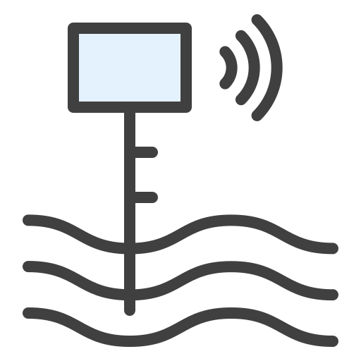
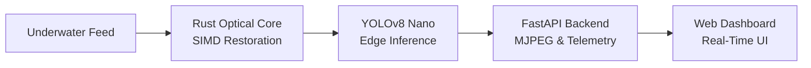
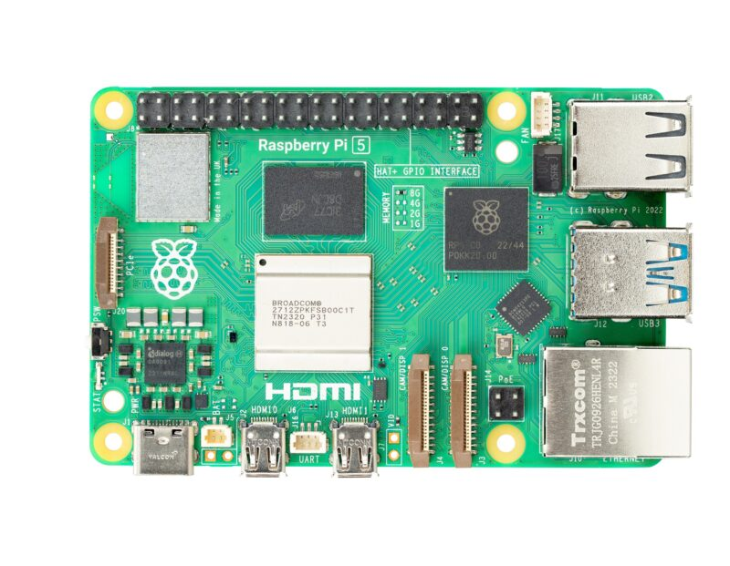

# Deep Sight Edge

Real-Time Underwater Optical Restoration & Edge AI Detection Platform

<p align="center">
  
</p>
Deep Sight Edge is a real-time edge computing pipeline designed to detect underwater objects, marine debris, and aquatic life from live camera feeds and video recordings. It combines a SIMD-accelerated Rust optical restoration engine with a fine-tuned YOLOv8 Nano neural network to clean up hazy, color-distorted underwater footage and detect submerged objects with high precision in real time.

---

## Architectural Diagram

```
+--------------------+      +-------------------------+      +----------------------+
|  Underwater Feed   | ---> | Rust SIMD Optical Core  | ---> | YOLOv8 Nano Edge     |
| (Camera / File)    |      | White Balance & CLAHE   |      | Detection Engine     |
+--------------------+      +-------------------------+      +----------------------+
                                                                        |
                                                                        v
+--------------------+      +-------------------------+      +----------------------+
| Operator Browser   | <--- | Real-Time Web Dashboard | <--- | FastAPI Edge Server  |
| Ground Station     |      | Telemetry & Controls    |      | MJPEG & REST API     |
+--------------------+      +-------------------------+      +----------------------+
```



---

## Demonstration

Real-time optical restoration, YOLOv8 object detection, and dynamic telemetry streaming:


https://github.com/user-attachments/assets/4fa504c2-aef6-44e1-8f7a-869d7941e636


---

## Features

- **Optical Restoration Engine**: SIMD-accelerated Gray World and Percentile white balancing, LAB color-space Contrast Limited Adaptive Histogram Equalization (CLAHE), and dynamic red-channel attenuation compensation implemented in Rust.
- **Edge AI Object Detection**: Custom-trained YOLOv8 Nano model (50 epochs, cosine LR decay, underwater-specific augmentations) detecting Marine Trash, Submersible Gear, and Biological specimens with 94.6% mAP50.
- **Side-by-Side Verification**: Real-time dual display showing raw degraded footage alongside restored and annotated output in horizontal or vertical split orientations.
- **Ultra-Low Latency Streaming**: Multipart MJPEG streaming over HTTP with sub-10ms delivery latency to any browser.
- **Ground Control Dashboard**: Zero-dependency browser interface with live FPS metrics, inference timers, detection count monitors, and live parameter tuning sliders.
- **Cross-Platform Edge Deployment**: Optimized for both NVIDIA CUDA systems and resource-constrained edge platforms such as the Raspberry Pi 5.

---

## Repository Structure

```
Deep-Sight-Edge/
|-- core/
|   |-- detector.py          # YOLOv8 edge inference & bounding box annotation
|   |-- enhancer.py          # Optical restoration wrapper (Rust core + Python fallback)
|   |-- pipeline.py          # Background video capture & processing coordinator
|-- rust_core/
|   |-- Cargo.toml           # Rust package manifest
|   |-- src/
|       |-- lib.rs           # SIMD image processing algorithms
|-- templates/
|   |-- index.html           # Ground control web dashboard
|-- web/
|   |-- css/dashboard.css    # Mission-control UI styling
|   |-- js/dashboard.js      # Telemetry polling & control synchronization
|   |-- img/logo.png         # Deep Sight Edge emblem
|-- doc/
|   |-- PI_5_TOP-small-800x621.jpg # Hardware documentation visual
|-- videos/
|   |-- test.mp4             # Sample underwater test footage
|   |-- screenrecording.mp4  # Execution demonstration video
|-- tools/
|   |-- benchmark_pipeline.py# Throughput and latency profiling tool
|   |-- export_video.py      # Batch video enhancement & inference exporter
|   |-- train_yolo.py        # Local YOLOv8 training script
|   |-- train_colab.ipynb    # Google Colab cloud training notebook
|-- main.py                  # Production entry point and CLI launcher
|-- server.py                # FastAPI web and streaming application
|-- edge_model.pt            # Fine-tuned YOLOv8 Nano model weights
|-- requirements.txt         # Python dependencies
|-- .gitignore               # Git ignore patterns
```

---

## Local Testing Guide

### Prerequisites
- Python 3.9, 3.10, or 3.11
- Git
- Optional: Rust toolchain (cargo) if compiling the native optical core from source

### 1. Clone the Repository
```bash
git clone https://github.com/rahul31124/Deep-Sight-Edge.git
cd Deep-Sight-Edge
```

### 2. Set Up a Virtual Environment
```bash
# Windows
python -m venv venv
venv\Scripts\activate

# Linux / macOS
python3 -m venv venv
source venv/bin/activate
```

---

### Setup for NVIDIA GPU Machines (CUDA)

For systems equipped with an NVIDIA GPU (GeForce, RTX, Quadro, Tesla), install PyTorch with CUDA acceleration before installing the remaining dependencies:

```bash
# Install PyTorch with CUDA 12.1 support
pip install torch torchvision --index-url https://download.pytorch.org/whl/cu121

# Install remaining dependencies
pip install -r requirements.txt
```

Verify GPU availability:
```bash
python -c "import torch; print('CUDA Available:', torch.cuda.is_available()); print('Device Name:', torch.cuda.get_device_name(0) if torch.cuda.is_available() else 'None')"
```

Run with GPU inference:
```bash
python main.py --video videos/test.mp4 --device 0 --port 8000
```

---

### Setup for Non-NVIDIA / CPU Laptops (Intel, AMD, Apple Silicon)

For laptops and workstations without a dedicated NVIDIA GPU, install the standard CPU distribution of PyTorch:

```bash
# Install CPU PyTorch
pip install torch torchvision

# Install remaining dependencies
pip install -r requirements.txt
```

Run with CPU inference:
```bash
python main.py --video videos/test.mp4 --device cpu --port 8000
```

### Accessing the Local Dashboard
Open your browser and navigate to:
```
http://localhost:8000
```
Note: On Windows, use `http://localhost:8000` or `http://127.0.0.1:8000`. Do not use `http://0.0.0.0:8000` in the browser bar.

---

## Command-Line Arguments

The `main.py` entry point accepts the following arguments:

| Argument | Type | Default | Description |
|---|---|---|---|
| `--video` | string | `test.mp4` | Video file path (e.g., `videos/test.mp4`) or camera index (`0` for USB/CSI camera). |
| `--model` | string | `edge_model.pt` | Path to YOLOv8 weights file. |
| `--conf` | float | `0.20` | Initial detection confidence threshold (0.01 to 1.00). |
| `--max-res` | int | `720` | Downscaling vertical resolution ceiling for real-time edge processing. |
| `--device` | string | `None` | Compute device (`0` for NVIDIA GPU, `cpu` for processor, or omitted for auto-detection). |
| `--host` | string | `0.0.0.0` | Binding host address (`0.0.0.0` allows access from local network). |
| `--port` | int | `8000` | Web server port number. |

Examples:
```bash
# Run on live webcam with CPU
python main.py --video 0 --device cpu --port 8000

# Run with custom confidence threshold and 480p ceiling for lower-power devices
python main.py --video videos/test.mp4 --conf 0.25 --max-res 480 --port 8080
```

---

## Raspberry Pi 5 Deployment

<p align="center">
  
</p>

The Raspberry Pi 5 (Broadcom BCM2712 quad-core ARM Cortex-A76 at 2.4 GHz) serves as an onboard compute unit for marine robotics.

### 1. Files Required on the Raspberry Pi 5

To run the pipeline on the Pi 5, the following project components must be transferred:

| Component | Path | Description |
|---|---|---|
| Pipeline Core | `core/` | Enhancer, detector, and pipeline manager modules |
| Rust Core | `rust_core/` | Native SIMD enhancement source code |
| Web Templates | `templates/` | Jinja2 dashboard template (`index.html`) |
| Web Assets | `web/` | CSS stylesheets, JavaScript scripts, and logo |
| Model Weights | `edge_model.pt` | Trained YOLOv8 Nano weights |
| Main Launcher | `main.py` | System initialization script |
| Web Server | `server.py` | FastAPI application |
| Dependencies | `requirements.txt` | Python package specifications |
| Test Video | `videos/test.mp4` | Optional test footage for validation |

Files that should not be transferred: virtual environments (`venv/`), Git tracking directory (`.git/`), and compilation caches (`target/`, `__pycache__/`).

### 2. Transfer Files via SCP

From your host computer terminal, copy the project files to the Raspberry Pi:

```bash
scp -r core rust_core templates web edge_model.pt main.py server.py requirements.txt videos pi@<PI_IP_ADDRESS>:~/Deep-Sight-Edge/
```
Replace `<PI_IP_ADDRESS>` with the IP address of your Raspberry Pi 5 on the local network.

### 3. Install System Dependencies on the Pi 5

SSH into the Raspberry Pi 5:
```bash
ssh pi@<PI_IP_ADDRESS>
cd ~/Deep-Sight-Edge
```

Install the required system packages, Rust toolchain, and media libraries:
```bash
sudo apt update
sudo apt install -y python3-pip python3-venv cargo libgl1 libglib2.0-0 v4l-utils
```

### 4. Build the Rust Optical Core

Compile the Rust SIMD acceleration engine directly on ARM64 Cortex-A76 architecture:
```bash
cd rust_core
cargo build --release
cd ..
```

### 5. Install Python Dependencies

Create an isolated virtual environment and install the Python stack:
```bash
python3 -m venv venv
source venv/bin/activate
pip install --upgrade pip
pip install -r requirements.txt
```

### 6. Run on the Raspberry Pi 5

**Using a connected USB / CSI camera (device 0):**
```bash
python main.py --video 0 --max-res 480 --device cpu --port 8000
```

**Using the included test video footage:**
```bash
python main.py --video videos/test.mp4 --max-res 480 --device cpu --port 8000
```

### 7. View the Dashboard Over Local Wi-Fi

Open any web browser on a laptop, tablet, or mobile phone connected to the same Wi-Fi network as the Raspberry Pi:
```
http://<PI_IP_ADDRESS>:8000
```

---

## REST and Streaming API Documentation

The FastAPI backend exposes the following endpoints:

### 1. Ground Control Dashboard
- **Endpoint**: `GET /`
- **Response**: `text/html`
- **Description**: Renders the mission-control dashboard with live MJPEG feed viewer, telemetry graphs, and parameter control sliders.

### 2. Real-Time Video Feed
- **Endpoint**: `GET /video_feed`
- **Response**: `multipart/x-mixed-replace; boundary=frame`
- **Description**: High-throughput multipart MJPEG video stream delivering composite (side-by-side or processed) frames to HTML `` elements or video players.

### 3. Pipeline Telemetry
- **Endpoint**: `GET /api/stats`
- **Response**: `application/json`
- **Description**: Returns instantaneous performance metrics, processing latencies, active configuration, and object detection statistics.

**Example Response:**
```json
{
  "fps": 28.4,
  "enhancement_ms": 6.8,
  "yolo_ms": 19.3,
  "counts": {
    "Trash": 3,
    "Bio": 1,
    "Submersible_Gear": 0
  },
  "apply_enhancement": true,
  "side_by_side": true,
  "split_orientation": "horizontal",
  "conf_thresh": 0.20,
  "red_gain": 1.25,
  "clip_limit": 2.0
}
```

### 4. Dynamic Parameter Configuration
- **Endpoint**: `POST /api/config`
- **Request Content-Type**: `application/json`
- **Response**: `application/json`
- **Description**: Updates optical restoration filter gains, split view orientation, and detection confidence thresholds in real time without restarting the pipeline.

**Request Body Schema:**
```json
{
  "apply_enhancement": true,
  "side_by_side": true,
  "split_orientation": "horizontal",
  "conf_thresh": 0.35,
  "red_gain": 1.40,
  "clip_limit": 2.5
}
```

| Parameter | Type | Range | Description |
|---|---|---|---|
| `apply_enhancement` | boolean | `true` / `false` | Enable or bypass the optical restoration stage. |
| `side_by_side` | boolean | `true` / `false` | Enable dual-stream comparison view. |
| `split_orientation` | string | `"horizontal"` / `"vertical"` | Orientation for side-by-side comparison. |
| `conf_thresh` | float | `0.05` - `1.00` | YOLOv8 minimum detection confidence threshold. |
| `red_gain` | float | `0.50` - `3.00` | Red channel attenuation compensation multiplier. |
| `clip_limit` | float | `1.00` - `5.00` | CLAHE contrast enhancement threshold. |

**Example Response:**
```json
{
  "status": "success",
  "updated": {
    "fps": 28.4,
    "enhancement_ms": 6.8,
    "yolo_ms": 19.3,
    "counts": {
      "Trash": 3,
      "Bio": 1,
      "Submersible_Gear": 0
    },
    "apply_enhancement": true,
    "side_by_side": true,
    "split_orientation": "horizontal",
    "conf_thresh": 0.35,
    "red_gain": 1.4,
    "clip_limit": 2.5
  }
}
```

---

## Model Training & Specifications

The detection model is a specialized YOLOv8 Nano architecture fine-tuned on real underwater debris datasets:

- **Target Classes**:
  - `Bio` (Class 0): Marine organisms, sea life, and coral structures.
  - `Submersible_Gear` (Class 1): ROVs, diving apparatus, anchors, and subsea cables.
  - `Trash` (Class 2): Anthropogenic plastic waste, bottles, nets, metal scrap, and debris.
- **Training Dataset**: 7,308 training images, 1,795 validation images.
- **Augmentation Strategy**: Cosine learning rate schedule, underwater hue variations, saturation shifts simulating turbidity, and depth-dependent luminance adjustments.
- **Performance**: 94.6% mAP50 at 640x640 edge resolution.
- **Training Artifacts**: Training scripts are available in `tools/train_yolo.py` and the interactive Google Colab notebook `tools/train_colab.ipynb`.

---
